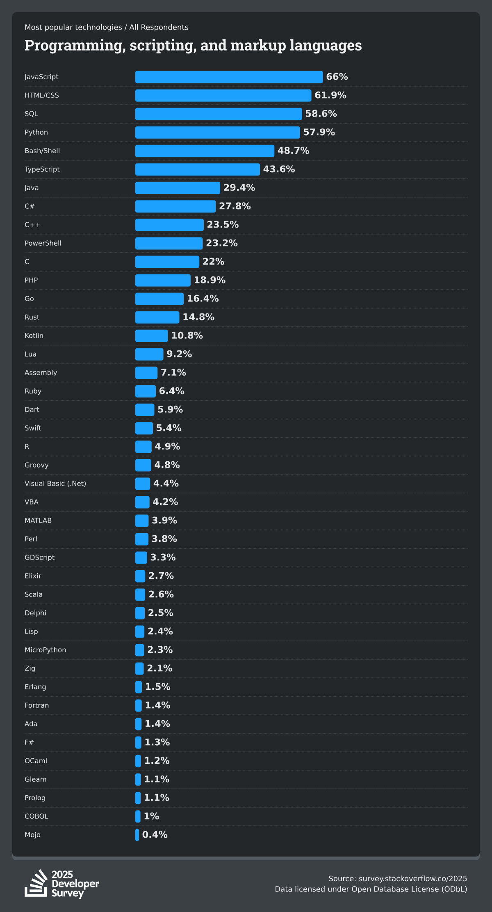

## State of Rust in these days

* Big Company use cases
* Trend
* Intro

---

## Use cases

<ul>
<li class="mb-4"> <a href="https://security.googleblog.com/2022/12/memory-safe-languages-in-android-13.html">Memory Safe Languages in Android 13</a></li>
<li class="mb-4"> <a href="https://discord.com/blog/why-discord-is-switching-from-go-to-rust">Why Discord is switching from Go to Rust</a></li>
<li class="mb-4">CloudFlare:  <a href="https://github.com/cloudflare/pingora">Pingora is a Rust framework to build fast, reliable and programmable networked systems</a></li>
</ul>

---

## Trend

Survey Stackoverflow

Jet Brain

